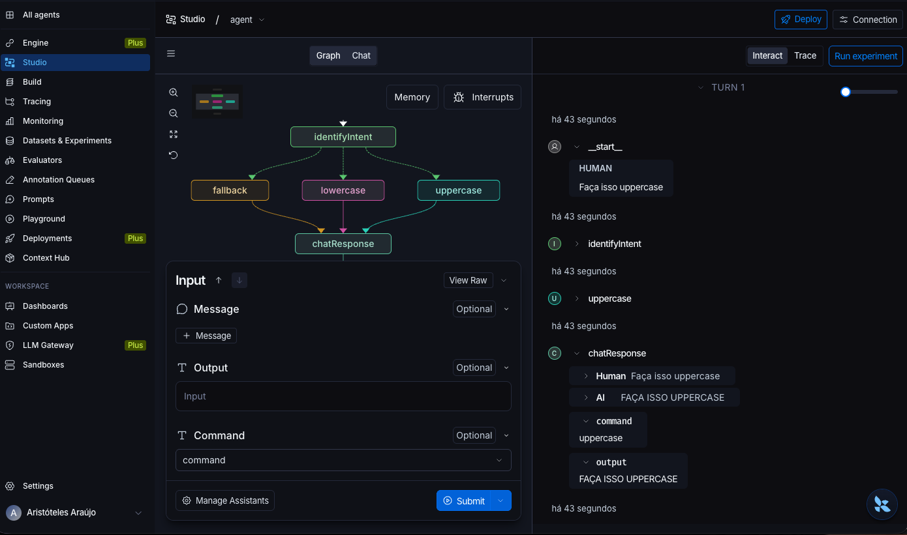
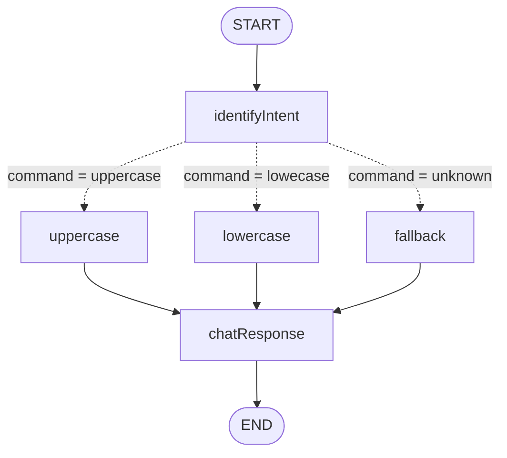

# LangChain Intro: roteador de comandos com LangGraph

Projeto da aula **Introdução ao LangChain.js: Pipes, Fluxos Condicionais e Gerador de Apps**,
do módulo **APIs de IA Generativa e Prompt Engineering** da pós-graduação
**Engenharia de Software em IA Aplicada** da **UNIPDS**.

Um grafo do **LangGraph.js** que lê a mensagem do usuário, identifica a intenção e, por meio de
**arestas condicionais**, encaminha o texto para o nó certo: converter para MAIÚSCULAS, para
minúsculas ou responder com uma mensagem de ajuda. O grafo é exposto por uma API HTTP
(**Fastify**) e pode ser inspecionado visualmente no **LangGraph Studio**.



## Como funciona



| Nó | Responsabilidade |
| --- | --- |
| `identifyIntent` | Lê a última mensagem e define o `command`: contém "upper" → `uppercase`, contém "lower" → `lowecase`, senão `unknown` |
| `uppercase` | Converte o `output` para MAIÚSCULAS |
| `lowercase` | Converte o `output` para minúsculas |
| `fallback` | Devolve uma mensagem de ajuda com os comandos aceitos |
| `chatResponse` | Transforma o `output` em uma `AIMessage` e adiciona ao histórico |

O estado do grafo é um schema **Zod** com três campos:

- `message`: histórico de mensagens (`BaseMessage[]`). Usa o reducer de mensagens do LangGraph, então cada nó **acrescenta** mensagens em vez de sobrescrever.
- `output`: o texto que está sendo processado.
- `command`: a intenção identificada (`uppercase` | `lowecase` | `unknown`).

### Exemplo

```bash
curl -X POST http://localhost:3000/chat \
  -H 'content-type: application/json' \
  -d '{"question": "Faça isso uppercase"}'
# FAÇA ISSO UPPERCASE
```

## Stack

- Node.js 24.11.1 (TypeScript executado nativamente, sem build), fixado em `.nvmrc`
- [LangGraph.js](https://langchain-ai.github.io/langgraphjs/) + LangChain.js (`StateGraph`, arestas condicionais, mensagens)
- Zod (schema do estado)
- Fastify (API HTTP)
- `node:test` (testes end-to-end)
- LangGraph Studio + LangSmith (visualização e tracing)

## Estrutura

```
.
├── src/
│   ├── index.ts                 # sobe o servidor Fastify na porta 3000
│   ├── server.ts                # rota POST /chat → graph.invoke()
│   └── graph/
│       ├── graph.ts             # estado (Zod) + montagem do StateGraph
│       ├── factory.ts           # export usado pelo LangGraph Studio
│       └── nodes/               # um arquivo por nó do grafo
├── tests/
│   └── router.e2e.test.ts       # testes e2e da rota /chat
├── docs/images/                 # imagens do README
├── langgraph.json               # registro do grafo para o LangGraph CLI
├── .env.example                 # variáveis do LangSmith
└── .nvmrc                       # versão do Node
```

## Como rodar

```bash
nvm use                 # Node 24.11.1
npm install
cp .env.example .env    # preencha LANGSMITH_API_KEY
```

**API HTTP** (porta 3000):

```bash
npm run dev
```

**LangGraph Studio** (servidor em `http://localhost:2024`):

```bash
npm run langgraph:serve
```

Depois abra o [LangGraph Studio](https://smith.langchain.com/studio?baseUrl=http://localhost:2024),
adicione uma **Message** (não use o campo Output) e envie, por exemplo, `Faça isso uppercase`.

## Testes

```bash
npm run test:dev
```

Roda os testes em modo watch com o test runner nativo do Node. Os testes sobem o Fastify
em memória (`app.inject`) e cobrem os três caminhos do grafo:

- mensagem com "uppercase" → texto em MAIÚSCULAS
- mensagem com "lowercase" → texto em minúsculas
- comando desconhecido → mensagem de ajuda do `fallback`
